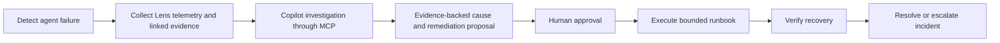

# agenticops-control-tower — Roadmap & Architecture

**Current package version: 0.8.0.** Phase 8 adds periodic detection, durable alerts and incident console views. v0.5 persists pushed Lens, Evals,
Sidecar and Chaos evidence and surfaces its freshness and native outcomes as
posture across the Python API, HTTP, CLI, offline snapshots and console.
0.5.1 adds AgenticLens 0.7.0 diagnosis reports as native Lens evidence
(faulty step and agent, attribution outcome, failure categories).

## Product Vision: AI-Native Operations Command Center

**OPERATE:** A central control plane for discovering, monitoring, configuring,
and operating agents and DeepAgentLabs capabilities across environments, and
an AI-native operations command center for autonomous agents. It combines live
traces and telemetry, human approval gates, AI-assisted troubleshooting through
MCP and an operations copilot, and automated runbooks to detect, diagnose,
remediate and verify recovery in real time.

This is the intended product, not a description of features already shipped.
Today's registry, inventory, status and native artifact readers are its foundation.
The investigation prompt and authorized tools ship in 0.6.0; the MCP host supplies
the model. No particular third-party Copilot product is required.

The core operator workflow is:



Tower owns the incident lifecycle and investigation workflow. Lens owns trace
capture and analysis, Evals owns scoring and release gates, Sidecar supervises
agent actions, and Chaos supplies controlled resilience scenarios. MCP exposes
real tools and APIs to the copilot; it does not supply causal reasoning by itself.
AIOS remains the draft shared-semantics authority.

Root-cause findings must cite the traces, tool calls, prompt versions, dependency
errors and timeline that support them. Distinguish confirmed causes from
hypotheses, state confidence and missing evidence, and never present an
unsupported explanation as an exact RCA.

## Release Status

- **v0.1** ✅ Implemented and published — registration, heartbeat, metadata, capability discovery,
  HTTP API, optional SQLite persistence, and reader/writer bearer authorization
- **v0.2** ✅ Implemented and published — HTTP and snapshot CLI, shared health rollups,
  capability coverage and version inventory, and agent filters
- **v0.3** ✅ Implemented and published — AgenticOps Console (read-only dashboard)
- **v0.4** ✅ Implemented and published — Configuration Model and Controlled Write Operations
- **v0.5** ✅ Implemented — Ecosystem evidence ingestion, persistence and posture views (push-based; pull collection deferred)
- **v0.6.0** ✅ Implemented — Phase 6 MCP investigation and Phase 6A approved staging recovery (one release)
- **v0.7.0** ✅ Implemented — Multi-Agent Operations and Bulk Actions
- **v0.8.0** ✅ Implemented — Live Detection, Alerts, Audit Trails, and Incident Views
- **v0.9** 🚧 Planned — Automated Runbooks and Recovery Workflows
- **v1.0** 🚧 Planned — Stable Control Plane and Published Capability Contract

v0.1 and v0.2 share a tested Python control model, optional SQLite registry,
authenticated HTTP API and operator CLI. The read-only console ships in v0.3; controlled desired configuration ships in
v0.4; ecosystem evidence posture ships in v0.5. Pull-based remote collection,
production runtime adapters remain planned; live detection and incident console views ship in v0.8.0.

## Implementation Evidence and Operational Limits

The implementation lives under `src/agenticops_control_tower/`:

| Capability | Implementation | Acceptance tests |
| --- | --- | --- |
| Phase 6/6A incidents, investigation, approval and verified staging recovery | `incidents/`, `adapters/containment.py`, `api/http.py`, `cli/main.py` | `tests/test_incidents.py`, `examples/incident_recovery.py` |
| Registry, discovery and persistence | `registry/service.py`, `discovery/service.py` | `tests/test_registry.py`, `tests/test_milestones.py` |
| Shared status, HTTP API and CLI | `status/service.py`, `api/surface.py`, `api/http.py`, `cli/main.py`, `snapshot.py` | `tests/test_http_api.py`, `tests/test_cli.py` |
| Read-only console and minimum-version assessments | `console/static/`, `models/version.py`, `ControlTowerAPI.assess_versions` | `tests/test_console.py` |
| Desired configuration, approvals and audit | `config/service.py`, `config/models.py` | `tests/test_configuration.py` |
| Native producer evidence and Sidecar journal readback | `adapters/evidence.py`, `adapters/sidecar_journal.py`, `models/evidence.py`, `examples/inspect_sidecar_journal.py` | `tests/test_ecosystem_alignment.py`, `tests/test_sibling_artifacts.py`, `tests/test_sidecar_journal_example.py`, `tests/test_sidecar_journal_adapter.py` |
| Evidence ingestion, history and posture | `evidence/store.py`, `evidence/posture.py`, `api/http.py`, `cli/main.py`, `snapshot.py`, `console/static/` | `tests/test_evidence_store.py`, `tests/test_evidence_posture.py`, `tests/test_evidence_api.py`, `tests/test_evidence_http.py`, `tests/test_evidence_cli.py`, `tests/test_evidence_snapshot.py`, `tests/test_evidence_examples.py`, `tests/console_ui.cjs` |

Tests cover restart durability, concurrent heartbeats, detached registry reads,
authorization, unknown-agent errors, filters, coverage, snapshots and console
asset serving. Native readers preserve producer outcomes independently of fleet
health; v0.3.1 preserves Sidecar decision IDs, trigger details and causal links.
v0.5 persists pushed evidence idempotently and reports fresh/stale/missing
posture per producer without changing reported health.
The console's public shell carries no inventory and exposes read-only controls.

Optional SQLite persistence supports a single host with a shared local database
file. Authentication uses deployment-configured reader/writer bearer tokens;
per-agent identities and tenant isolation are not implemented. Without tokens,
the API allows anonymous local development. Health is agent-reported;
timeout-based health, automatic package detection and distributed storage remain
planned. Pull-based remote evidence collection and remote configuration application,
production runbooks remain planned. Periodic latest-observation incident detection ships in v0.8.0.
Phase 6/6A delivers explicit detection, investigation and approved verified recovery
for the deterministic staging fixture; see docs/incident-recovery.md.

Run `make check` for lint, formatting, strict typing and tests. Run
`make test-ecosystem` against local sibling checkouts, or the published Sidecar
checks documented in [PRE_RELEASE.md](PRE_RELEASE.md). Optional producer tests
skip when siblings are absent. The release checklist also verifies wheel/sdist
metadata, installed CLI, packaged console assets and standalone evidence reads.
Console DOM checks documented in README verify behavior; they do not replace
visual browser QA.

## Design Constraints

These should shape the build order from the start, not be rediscovered later.

1. **Inventory before orchestration.** The first release should answer
   "what exists and what is installed?" before attempting "change it
   remotely." A control plane without trusted inventory is theater.
2. **Read-only before write-capable.** Cross-agent configuration and
   operations are the highest-risk part of the vision. Prove registration,
   discovery, and status first.
3. **API and CLI before dashboard.** The web console should sit on top of the
   same control model, not become the place where the actual behavior lives.
4. **Capability adapters should stay thin.** Control Tower should reuse
   sibling project contracts and metadata rather than re-implement Lens,
   Evals, Sidecar, or Chaos logic locally.
5. **Runtime-agnostic means avoiding runtime assumptions in v0.1.** Do not
   build the first version around Kubernetes-specific or cloud-specific
   registration mechanics.
6. **MCP is downstream of the control API.** Agentic MCP integration is
   valuable, but only after there is a real control-plane surface to expose.
7. **Automatic discovery where possible, explicit registration where
   necessary.** The architecture should prefer discovery, but not block the
   product on perfect autodetection across every environment.

8. **Evidence before causal claims.** Copilot findings cite source artifacts;
   absent evidence stays absent, and hypotheses remain explicit.
9. **Approval before remediation.** The first incident loop requires a human
   approval bound to the exact target and action parameters. MCP or copilot
   access never bypasses authorization.
10. **Execution is not recovery.** Successful commands do not resolve incidents;
    recovery requires recorded checks against telemetry and explicit criteria.

## Cross-Project Dependencies

`agenticops-control-tower` is the ecosystem control plane, so its roadmap is
mostly about coordinating with sibling projects without absorbing them.

- `agentic-evals`
  Coordinate with: evaluation reports, metric/tag summaries, and release-gate
  decisions; scoring and gate computation remain owned by Evals.
- `agenticlens`
  Coordinate with: how Control Tower reads summarized observability and readiness signals without replacing Lens
  analysis or duplicating Evals scoring.
- `agentic-sidecar`
  Coordinate with: how governance posture, decision summaries, and risk
  signals are surfaced centrally once Sidecar exposes stable runtime output.
- `agentic-chaos`
  Coordinate with: how experiment inventory, last-run status, and resilience
  posture are summarized in the control plane once Chaos artifacts stabilize.
- `mcp-server` (`deep-agentic-core-mcp`)
  Validate in: a future MCP-facing path for AI-native operation against
  Control Tower rather than only against individual sibling packages.
- `ai-operations-spec`
  Coordinate with: agent identity, capability metadata, status events,
  configuration contracts, and operational artifacts that should not drift
  away from the shared ecosystem model.

For roadmap planning, use these meanings consistently:

- `Depends on`: the item cannot ship first.
- `Coordinate with`: sibling repos should be updated in the same window.
- `Validate in`: end-to-end checks should happen in another repo or adapter.

## Definition of Done

A roadmap item is done only when all applicable work is complete:

- implementation is merged and usable through the intended API, CLI, or UI
- tests or fixtures cover the behavior
- operator-facing docs and examples are updated
- `README.md` and this roadmap are updated when the feature changes user
  expectations or milestone status
- capability contracts and ecosystem-facing artifact shapes are documented
- sibling-project checks are recorded where relevant
- release metadata is updated when the work is part of a release-ready change
  set

---

## Architecture

Control Tower should become the **operate/manage layer** across the
DeepAgentLabs stack:

```text
Control Tower = OPERATE
Agentic MCP   = CONNECT
AgenticLens   = OBSERVE
Agentic Evals = EVALUATE
Agentic Sidecar = SUPERVISE
Agentic Chaos = TEST
AI Operations Specification = STANDARDIZE
```

From a developer or operator perspective, the project exists to answer:

`What agents do I have, where are they running, what DeepAgentLabs
capabilities are installed, what is unhealthy, and how do I manage all of that
through one control plane?`

That keeps the package focused on:

- agent registry and lifecycle visibility
- capability inventory and discovery
- control-plane API design
- centralized configuration and safe operations
- operator UX across CLI, console, and AI-facing control

It should not become a hidden duplicate of the sibling runtimes.

## Proposed Product Surfaces

```text
agenticops-control-tower
├── registry/        # agent inventory, heartbeat, runtime metadata
├── discovery/       # capability detection and version inventory
├── api/             # unified control-plane API
├── config/          # central configuration model and safe write paths
├── cli/             # operator CLI
├── console/         # AgenticOps Console / dashboard
└── adapters/        # thin ecosystem adapters (Lens, Evals, Sidecar, Chaos, MCP)
```

This is a proposed shape, not a committed implementation layout.

## Capability Direction

Over time, the control plane should grow around a few clear domains:

- inventory and registration
- health and readiness
- capability discovery
- version and compatibility visibility
- centralized configuration
- operational actions
- auditability and incident posture
- AI-native control through MCP

Contributors should be able to ask:

`Is this feature helping operators understand or safely control deployed
agents, or is it really work that belongs in Lens, Evals, Sidecar, Chaos, MCP, or the
spec repo instead?`

---

## Build Order

## Phase 0: Concept and Product Boundary

Status: complete

Goals:

- define what Control Tower is and is not
- keep boundaries clear against Lens, Evals, Sidecar, Chaos, MCP, and AIOS
- narrow the first implementation into a believable control-plane core

Deliverables:

- [x] architecture concept document
- [x] `README.md`
- [x] `ROADMAP.md`
- [x] implementation scaffold

## Phase 1: Registry and Discovery Core (`v0.1`)

Status: **implemented and published** — see [implementation evidence](#implementation-evidence-and-operational-limits).

Goals:

- create a minimal agent registry — done, memory or durable SQLite
- accept explicit agent registration and heartbeats — done
- record runtime, framework, environment, and package metadata — done
- expose a read-only API for listing agents and capabilities — done, plus
  the write endpoints below, all HTTP-reachable via the optional `api` extra

Suggested initial surface (all implemented in `api/http.py`):

- [x] `POST /agents/register`
- [x] `POST /agents/{id}/heartbeat`
- [x] `GET /agents`
- [x] `GET /agents/{id}`
- [x] `GET /capabilities` (aggregated across all registered agents)

Success criteria:

- [x] operators can see which agents are known to the system
- [x] each agent record includes capability versions and last-seen status
- [x] the system works without assuming Kubernetes, Docker, or one framework
- [x] example registration payloads exist for at least two runtime styles
      (`examples/sample_agent_registration.json`,
      `examples/sample_agent_registration_kubernetes.json`)

SQLite persistence is enabled with `serve --database registry.sqlite`. Reader and
writer bearer tokens are configured with `AGENTICOPS_READ_TOKEN` and
`AGENTICOPS_WRITE_TOKEN`. Anonymous in-memory mode remains available for local use.

Delivered in `v0.1`:

- thread-safe registry with explicit registration payloads and optional SQLite storage
- reader/writer authorization on every inventory and mutation HTTP route
- heartbeat updates with last-seen tracking and metadata merging
- aggregated capability inventory across known agents
- runtime-agnostic examples for Lambda-style and container-style agents
- tests covering registration, heartbeat, and discovery flows

## Phase 2: CLI and Status Model (`v0.2`)

Status: **implemented and published** — see [implementation evidence](#implementation-evidence-and-operational-limits).

Goals:

- ship a first operator CLI — done (`agenticops-control-tower`, optional
  `api` extra)
- add health rollups and version inventory summaries — done
- expose useful filters such as unhealthy agents or agents missing a
  capability — done

Suggested commands (shipped as `agenticops-control-tower <command>`, not
`deepagent <command>` -- no `deepagent` binary exists in this ecosystem):

- [x] `agents list`
- [x] `agents get <agent-id>`
- [x] `capabilities list`
- [x] `status` (health rollup and capability coverage)

Success criteria:

- [x] CLI and API share the same underlying control model (the CLI is an
      HTTP client of `api/http.py`, which wraps the same `ControlTowerAPI`
      facade used directly by tests)
- [x] a user can answer basic inventory questions without touching raw JSON
- [x] health rollups use the same reported status buckets across Python, HTTP and CLI

Delivered in `v0.2`:

- `agenticops-control-tower` console script for operator workflows
- status rollups shared between CLI and Python API
- agent filters for health status, environment, present capability, and missing capability
- capability coverage summaries and fleet status views
- snapshot-based CLI input for offline read-only inspection

## Phase 3: Read-Only Console (`v0.3`)

Status: **implemented and published**. `/console/` is served
by the optional HTTP app with packaged HTML/CSS/JS. It consumes authenticated
read APIs for health, filtered inventory, capability coverage, explicit minimum
version assessments and agent details. The evidence-readiness view states that
collection/persistence and incident workflows are unavailable; no remediation
controls are exposed. See `tests/test_console.py`.

Goals:

- ship the first AgenticOps Console
- visualize inventory, health, versions, and capability presence
- prepare a read-only incident/evidence view without implying remediation is available
- keep the dashboard read-only at first

Success criteria:

- the console is a thin view over the real API
- one operator can identify unhealthy or outdated agents quickly
- the dashboard does not introduce write-side behavior the API cannot do

## Phase 4: Configuration and Safe Write Operations (`v0.4`)

Status: **implemented and published for Tower-owned desired configuration**. See
[configuration.md](docs/configuration.md), `config/service.py` and
`tests/test_configuration.py`. API/CLI expose previews, separate approver
credentials, denial, expiry, revocation, revision checks and atomic one-use writes.
SQLite persists configuration, actions and audit across restarts. Local atomic
writes cannot partially commit. The reusable result contract explicitly carries
failure, rollback and reconciliation fields for later adapters.

Runtime configuration remains mirrored/unsupported without a writable adapter.
Remote stop/revoke and task-scope transport are deferred; Python operator scopes
bound configuration actions to deployment IDs. No generic sibling toggle is claimed.


Goals:

- define a central configuration model for supported capabilities
- add controlled write paths for safe updates
- document which configuration is authoritative versus merely mirrored
- define reusable authorization, action preview, approval and audit contracts
  for later remediation; include target, parameters, impact and expiry
- reject execution when approval is denied, expired, or no longer matches the
  proposed action; capture partial failure and rollback/reconciliation results

Potential operations:

- `config.get(agent_id)`
- `config.update(agent_id, patch)`
- `capabilities.enable(agent_id, capability)`
- `capabilities.disable(agent_id, capability)`

Open risk:

- configuration semantics will differ across Lens, Sidecar, and Chaos, so
  v0.4 must avoid pretending one generic toggle model covers everything.

Success criteria:

- write operations are auditable
- partial failure behavior is explicit
- unsupported configuration surfaces degrade honestly

## Phase 5: Ecosystem Surface Integration (`v0.5`)

Status: **implemented (push-based collection)**. Native JSON readers and the
Tower-local evidence-link contract feed an idempotent evidence store (memory or
SQLite) and per-producer posture across Python, HTTP, CLI, offline snapshots and
the console. See [evidence-posture.md](docs/evidence-posture.md) and
[ecosystem-alignment.md](docs/ecosystem-alignment.md).

Delivered in `v0.5`:

- [x] push ingestion: `POST /evidence`, `ControlTowerAPI.ingest_evidence`, and CLI
      `evidence ingest`, `ingest-manifest` and `ingest-sidecar-journal`
- [x] durable, append-only evidence history with idempotent retries, future-time
      rejection, bounded HTTP bodies and Python pruning
- [x] agent and fleet posture: fresh/stale/missing freshness by `observed_at`,
      latest record (including unavailable), recent counts and native tallies
- [x] Lens run correlation: trace ID, timing, error type, tool names and failed
      spans, without storing span payloads or error messages
- [x] field-level unavailable diagnostics that do not echo producer values
- [x] console fleet posture panel and agent evidence table (still GET-only)
- [x] offline snapshots carry evidence evaluated as of `captured_at`
- [x] optional actual-producer checks against Lens 0.6.1, Evals 0.7.1,
      Sidecar 0.7.0 and Chaos 0.5.1

Deferred: pull collection from producer services and automatic producer
discovery, prompt-version correlation (no native Lens field), AIOS mapping,
journal integrity verification, retention policies and per-producer credentials.


Goals:

- surface Lens, Evals, Sidecar, and Chaos summaries in the control plane
- add live Lens trace/telemetry collection with explicit deployment, run and
  runtime-participant attribution, observation times and freshness — done for
  pushed evidence
- correlate tool calls, prompt versions and dependency failures with linked
  evidence; preserve source references and missing/unavailable data — tool and
  dependency failures done; prompt versions await a native Lens field
- keep adapters thin and contract-driven
- avoid copying sibling project logic into Control Tower

Examples:

- Lens: trace outcomes, operational evidence, recent findings
- Evals: evaluation summaries and existing release-gate outcomes
- Sidecar: decision summaries, risk posture, intervention counts
- Chaos: experiment inventory, last run, resilience posture

Success criteria:

- [x] operators can inspect high-level posture centrally
- [x] the source of truth for the underlying capability remains in the sibling
      package
- [x] integration failures degrade to "unavailable" rather than crashing the
      control plane

## Phase 6: Agentic MCP Connector and Investigation Copilot (`v0.6.0`)

Status: **implemented together with Phase 6A in 0.6.0**. Local MCP 0.3.6
exposes twelve authenticated Tower HTTP tools plus a cited investigation prompt.
Read/write credentials remain separate; human approval is HTTP/CLI-only. Hosted
MCP rejects Tower tools until per-user credential binding exists. The host
supplies the model; Tower assembles cited evidence and preserves uncertainty.
See [connector setup](docs/mcp-connector.md).

Goals:

- expose Control Tower to AI operators through Agentic MCP
- add an operations copilot over authorized evidence-query tools
- investigate incidents by correlating traces, tools, prompts, dependencies,
  deployment changes and sibling outcomes into a causal timeline
- produce a cited diagnosis and a proposed runbook with prerequisites, target,
  parameters, expected impact, rollback and recovery checks
- support AI-native inventory and status queries first
- add write-capable operations only after authorization and audit shape are
  clear

Examples:

- list registered agents
- list unhealthy agents
- show agents with outdated package versions
- inspect recent high-risk Sidecar posture

Success criteria:

- MCP connects to a real control API rather than a demo surface
- read and write operations have distinct authorization boundaries
- examples exist showing MCP with and without Control Tower

## Phase 6A: First Approved Incident-to-Recovery Scenario (`v0.6.0`)

Status: **implemented together with Phase 6 in 0.6.0** for the deterministic
local SQLite staging dependency runtime. Durable incidents, exact-preview
approvals, at-most-one dispatch, bounded runtime lock waits, fresh Lens/Evals
verification and probe-based recovery ship through real HTTP/CLI paths.
Partial execution and failed recovery escalate. See
[operator guide](docs/incident-recovery.md), `examples/incident_recovery.py`,
`incidents/` and `tests/test_incidents.py`. This is the first complete command-center demonstration,
not a requirement to finish every fleet-wide alerting feature first.

Depends on: v0.4 approval/authorization contracts, v0.5 evidence posture (pushed;
pull collection from the staging runtime may be added here), and v0.6 MCP
investigation tools. Bulk operations in v0.7 are not a prerequisite.

Scenario: a staging agent's tool dependency becomes unavailable. Use a controlled
Chaos scenario or deterministic fault fixture; Lens records the failed run and
dependency error. Tower detects the failure and opens a correlated incident.
The copilot explains the causal timeline using the recorded evidence and proposes
one supported remediation runbook. A human reviews and approves its exact target
and parameters. Tower executes the approved action through a bounded connector,
then runs a probe and verifies recovery using fresh Lens evidence and applicable
Evals checks. Failure to verify recovery keeps the incident open and escalates it.

Success criteria:

- [x] one supported staging runtime completes detect → investigate → recommend
      → approve → execute → verify, through real API/tool paths
- [x] the incident retains linked trace, tool, prompt and dependency evidence;
      unavailable evidence and uncertain causes remain explicit
- [x] the diagnosis cites source evidence and distinguishes a confirmed cause
      from a hypothesis; contradictory evidence prevents an unsupported RCA
- [x] the remediation preview specifies scope, parameters, impact, rollback and
      recovery criteria; approval is attributable and bound to that preview
- [x] denied, expired or modified approvals cause no remediation execution
- [x] actions have timeout and retry limits; duplicate requests cannot repeat
      an unsafe action; partial execution is recorded and reconciled
- [x] fresh telemetry, a successful probe and applicable Evals results determine
      recovery; a successful command alone cannot resolve the incident
- [x] the incident timeline records detection, investigation, approval,
      execution and verification, including failed-remediation paths
- [x] an end-to-end fixture and operator walkthrough demonstrate both verified
      recovery and escalation when recovery fails

## Phase 7: Multi-Agent Operations (`v0.7`)

Status: **implemented in 0.7.0**. Frozen deterministic environment/capability
targeting, bulk desired settings and stop/MCP-revocation coordination, separate
approval, durable per-target results and bounded acknowledgement waits ship
through Python, HTTP and CLI. See [fleet operations](docs/fleet-operations.md),
`bulk/`, `tests/test_bulk.py` and `examples/fleet_operations.py`. No fleet
atomicity, automatic rollback/resume or remote configuration application is claimed.

Goals:

- add bulk operations and fleet-wide targeting
- support environment-scoped and capability-scoped actions
- make operational intent explicit before write actions fan out

Examples:

- enable enhanced tracing for all staging agents
- find all agents missing a minimum Sidecar version
- pause a class of experiments across an environment

Success criteria:

- bulk actions include preview and audit paths
- rollback or reconciliation behavior is documented
- targeting semantics are deterministic

## Phase 8: Live Detection, Alerts, Audit, and Incident Views (`v0.8`)

Status: **implemented in 0.8.0**. `operations/` provides periodic latest-observation
rules, durable alert lifecycle/audit, explicit environment/run correlation and
joined incident views through API, CLI and the read-only console. See
[workflow, acceptance boundaries and limits](docs/live-operations.md) and
`tests/test_operations.py`, `tests/console_ui.cjs`, `examples/live_operations.py`.
External notifications, lossless streaming and production remediation remain
future work. Lens integrity/coverage are explicitly unverified/unassessed.

Goals:

- add operator-facing alerts and warnings
- expand the initial detection path into live telemetry-based rules with
  freshness, deduplication and correlation across agents and environments
- expose incident timelines, evidence, copilot findings, approval requests and
  recovery checks in the console; keep stale evidence visibly distinct
- add audit trails for configuration and operations
- add incident-oriented views over agent and capability posture

Success criteria:

- the system explains what changed, when, and by whom or by what control path
- incident views join inventory, health, and recent changes coherently

## Phase 9: Automated Runbooks and Recovery Workflows (`v0.9`)

Status: **planned**. Builds on the approved v0.6.0 scenario and the v0.8 incident
surface, extending one supported action into reusable operational workflows.

Goals:

- provide versioned runbooks with prerequisites, scoped targets, ordered actions,
  human approval gates, bounded retries/timeouts and rollback/reconciliation
- let the copilot recommend supported runbooks without inventing executable
  commands or extending an operator's authority
- automate execution and verification after approval; support cancellation,
  interruption recovery and escalation when actions or checks fail
- validate runbooks against controlled Chaos scenarios and record applicable
  Evals results, while leaving those engines in their owning packages

Success criteria:

- each execution records runbook version, evidence, approver, target, actions,
  outputs and verification results in a durable incident timeline
- permission and approval checks apply equally to console, CLI, API and MCP
- tests cover denied approval, changed scope, unavailable dependencies, timeouts,
  repeated requests, partial failure, failed recovery and successful recovery
- no remediation is considered complete until declared recovery criteria pass

## Phase 10: Stable Capability Contract (`v1.0`)

Goals:

- publish a stable capability discovery contract
- lock the core control-plane API semantics
- document supported runtime and framework integration patterns

Success criteria:

- at least two materially different runtimes are validated end to end
- capability metadata and status semantics are versioned
- Control Tower can be described as a stable control-plane product rather than
  a concept repo

---

## Open Questions

- What is the minimum viable registration contract for agents that is still
  useful across runtimes?
- Which fields should be standardized in AIOS versus left as Control Tower
  implementation detail?
- How much of capability discovery can be automatic versus agent-reported?
- When configuration updates fail midway across a fleet, what is the expected
  reconciliation model?
- Should the first implementation be a local-first Python service only, or
  should remote deployment concerns appear in v0.1?

## North Star

An AI-native operations command center where humans and AI operators can detect
agent failures, investigate live evidence, explain supported causes, approve
remediation, execute bounded runbooks and verify recovery across environments.
Fleet inventory and configuration are the foundation of this unified operations
workflow; the incident-to-recovery loop is a first-class product outcome.

## Operational safety coordination (planned)

Added 2026-10-11. Extend existing write/incident milestones. The current console
is read-only; registry/configuration access is not agent termination.

- [ ] v0.4: define authenticated operator roles and task/deployment-scoped stop/revoke
      contracts with command IDs, expiry and idempotency. Emergency stop must not
      depend on LLM approval or cooperation from the agent being stopped.
- [x] v0.6.0: thin Sidecar stop/restart and native MCP issuer revocation adapters
      with requested/acknowledged/unsupported outcomes; in-flight and downstream
      credentials remain explicit limits. See docs/incident-recovery.md.
- [ ] Report requested, acknowledged, failed and unsupported outcomes separately.
      Claim containment only after dispatch blocking and revocation are confirmed;
      expose in-flight calls, unreachable targets and unsupported downstream credentials.
- [x] v0.7: bulk stop/revoke with per-target results and bounded acknowledgement
      times; test partial failure/disconnection without assuming fleet atomicity.
- [x] v0.8: join operator commands, policy decisions and actual execution evidence
      in incident timelines; show Lens integrity/coverage status separately from health.
- [ ] Validate with Chaos attacks and Evals zero-violation gates, including queued
      calls, retries, denied tools and revocation races.

Tower coordinates; Sidecar enforces runtime decisions; MCP enforces its access
boundary; credential issuers own downstream revocation. Coordinate shared
command/event semantics with AI Operations Specification.

### Sidecar v0.7 compatibility update (2026-10-11)

Native decision readback preserves decision IDs, trigger details and causal
links from Sidecar v0.7 runtime journals. Optional actual-producer tests cover
all seven outcomes and unchanged deployment health. This extends the existing
read-only evidence contract; remote event collection, journal integrity checking
and operator stop/revoke coordination remain planned. See
[ecosystem alignment](docs/ecosystem-alignment.md#sidecar-v07-runtime-journal-readback).

## Sidecar 0.8 interoperability

Tower 0.5.1 retains its existing native Decision/journal readers and separate
deployment-health model. Sidecar 0.8 adds mandatory-scope fingerprints and
correlated evidence without changing Decision status semantics. Shared/Exclusive
context must not be copied into fleet views without reader authorization.

Sidecar 0.8 provides Shared/Exclusive context-only, guardrails-only or combined
configuration, explicit host context delivery and mandatory guardrail composition.
Exclusive rules cannot weaken shared restrictions. Cross-framework privacy,
revocation and delegated authority remain v0.9 validation; stable schemas remain
v1.0. Native correlated Lens readback requires Lens 0.7.1. All sibling packages
stay optional; no dependency floor is increased without a runtime requirement.
See the [Sidecar integration contract](https://github.com/DeepAgentLabs/agentic-sidecar/blob/main/docs/integrations.md).

## Native Evals contract validation — Control Tower 0.6.1

Published Evals report and gate schemas (0.7.2 at Tower 0.6.1; 0.9.0 since Tower 0.7.1) are now enforced in the native
consumer paths. Validation runs offline using bundled upstream contracts;
invalid artifacts fail with field-level diagnostics. Native verdicts and
AIOS conformance remain distinct. See [behavior, examples and migration](docs/evals-report-contract.md).

Agentic Evals 0.7.2 publishes native report (`schema_version: "1.0"`) and
gate-decision JSON Schemas, with offline `report_schema()` and
`gate_decision_schema()` accessors. Contract 1.x evolves additively; readers
should tolerate unknown fields. Tower continues to read native report/gate fields and display the producer verdict. Schema validation does not recompute a gate or establish evidence integrity.

See the [contract, examples and compatibility policy](https://github.com/DeepAgentLabs/agentic-evals/blob/main/docs/report-contract.md). Existing dependency
ranges remain sufficient; using the new accessors directly requires
`agentic-evals>=0.7.2`. This documentation alignment needs no sibling patch release.

## AgenticLens 0.8.0 suite management

AgenticLens 0.8.0 delivers its v0.6 milestone: `agenticlens.suites` and
`agenticlens suite` build regression suites from CSV/JSON imports, production
traces and user feedback. It masks PII by default before storage (`--no-mask`
opts out), detects duplicates and
conflicting labels, adds synthetic variations and stable splits, records
reviews, and approves suites into immutable, hash-verified versions that CI
verifies, exports and evaluates. Suites stay plain agentic-evals `TestSuite`
files.

Tower's native readers are unchanged. Lens 0.8.0 is inside Tower's
`agenticlens>=0.7,<1` extra. Approved suite versions are Lens-local
artifacts, not Tower evidence types; evaluation reports produced from them
keep the native shape Tower already reads. No Tower release is needed.

See the [suite management guide](https://github.com/DeepAgentLabs/agenticlens/blob/v0.8.0/docs/suite-management.md).

## AgenticLens 0.9.0 ModelFit

AgenticLens 0.9.0 delivers its v0.7 milestone: `agenticlens.modelfit` and
`agenticlens modelfit` recommend a model per task category from recorded
experiment reports, under hard quality, cost, latency, safety, provider and
deployment constraints that fail closed. Each recommendation carries a
confidence level with reasons, an explanation, alternatives, a fallback
(on a different provider when one is feasible), savings against a reference variant tied to the
experiment evidence, and quality risks, plus a task-level model matrix.

Tower's native readers are unchanged. Lens 0.9.0 is inside Tower's
`agenticlens>=0.7,<1` extra. A ModelFit report is a Lens-local
recommendation artifact, not a Tower evidence type: it neither reports fleet
health nor changes desired settings, and acting on a recommendation stays an
operator decision. No Tower release is needed.

See the [ModelFit guide](https://github.com/DeepAgentLabs/agenticlens/blob/v0.9.0/docs/modelfit.md).

## Evals 0.8.0 CLI interoperability

Evals 0.8.0 CLI JSON reports and gate decisions retain schema 1.0 and work with the native Evals evidence reader and the bundled schemas (0.7.2 at the time; 0.9.0 since Tower 0.7.1). Keep JSON artifacts when producing JUnit or Markdown for CI; presentation output is not a Tower evidence input. Gate results remain producer evidence, separate from deployment health and recovery authorization.

See [CLI usage and compatibility](docs/evals-0.8-cli.md).

## Evals 0.9.0 judge reliability — Control Tower 0.7.1

Tower 0.7.1 bundles the Evals 0.9.0 native report and gate schemas and projects
the new optional judge summary (unavailable judgments, judge cost, lowest
agreement) and live-target summary (retried, timed-out and errored cases) into
evaluation evidence. Both are `null` in reports written before Evals 0.9.0;
`summary.live` is also `null` for offline runs, and `summary.judge` for runs
without judge scores. The producer's gate
decision is carried unchanged, and judge or target outcomes are not deployment
health. See [the compatibility note](docs/evals-0.9-judge-reliability.md).

## Evals 0.10.0 evaluation evidence

Evals 0.10.0 exports reports as AIOS `0.4-draft` `evaluation` evidence merged
into a Run. Tower's native report and gate validation is unchanged (the
schemas are identical), and Tower does not read AIOS Runs. An aligned Run is
not fleet health or a passing gate. The development pin moves to 0.10.0, and the
`agentic-evals>=0.7.2,<1` extra already admits it. No Tower release is needed.
See [the compatibility note](docs/evals-0.10-aios-evidence.md).

## Chaos 0.7.0 interoperability

Chaos 0.7.0 adds sequential fault cascades, deterministic monotonic breaking-point
search, synthetic response poisoning (including prompt/tool-response instruction
and policy-bypass payloads), and explicit-price retry cost estimates. Native
child event IDs and fault types remain intact; cascade IDs/stages and poisoning
strategy/payload/seed are additive event detail. Existing report readers and
AIOS exports remain compatible.

See the [v0.7 guide and offline synthetic example](https://github.com/DeepAgentLabs/agentic-chaos/blob/v0.7.0/docs/v0.7.md).
The example includes observed synthetic dispatches and a bypassed negative
control. Injection or recovery alone does not prove containment. No new shared
schema, automatic adapter, hosted execution capability or containment guarantee
is introduced.

Tower summarizes native Chaos event counts; resilience outcomes remain separate from deployment health. Its agentic-chaos>=0.5,<1 extra already admits 0.7. No Tower patch release is needed.

## AgenticLens 0.10.0 routing compatibility

See the [local integration boundary guide](docs/lens-0.10-routing.md).

AgenticLens 0.10.0 implements roadmap v0.8: evidence-based runtime model
selection, fail-closed routing constraints, bounded provider failover,
confidence/escalation handoffs, shadow/canary modes and a local routing journal.
The default is advisory; execution uses explicit caller-owned callbacks.
MCP 0.3.12 exposes read-only `lens.routing_decide` and pins hosted Lens 0.10.0.
See the [routing guide](https://github.com/DeepAgentLabs/agenticlens/blob/v0.10.0/docs/routing.md)
and [offline example](https://github.com/DeepAgentLabs/agenticlens/blob/v0.10.0/examples/routing_demo.py).

Fleet inventory, desired host settings, authenticated approval and native producer
evidence remain Tower-owned. Routing decisions are Lens-local artifacts; no new
automatic Tower reader or native posture tally is introduced. Route selection
is not deployment health or a Tower approval. Existing optional ranges remain
sufficient; no Tower patch release is required.

## AgenticLens 0.11.0 optimization compatibility

See the [compatibility note](docs/lens-0.11-optimization.md).

AgenticLens 0.11.0 implements roadmap v0.9 Optimization Intelligence:
evidence-backed recommendations from recorded traces for prompts (caching,
compression), retrieval (top-k pruning, reranking), memory (summarization,
retention), tools (result caching, non-retryable errors), workflows (redundant
steps, handoffs that add no work) and models (quality-cost trade-offs between
variants). Projected benefit, confidence and quality risk stay separate; an
append-only ledger tracks accepted, rejected, adopted and reverted
recommendations; and adopted changes are evaluated against later traces, with
projected and observed outcomes side by side. Recommendations are advisory.
MCP 0.4.3 exposes read-only `lens.optimization_analyze` and pins hosted Lens
0.11.0. See the [optimization guide](https://github.com/DeepAgentLabs/agenticlens/blob/v0.11.0/docs/optimization.md)
and [offline example](https://github.com/DeepAgentLabs/agenticlens/blob/v0.11.0/examples/optimization_demo.py).

The optional `agenticlens>=0.7,<1` range already admits 0.11.0 and the
development lock is unchanged. Tower does not ingest optimization reports, and
Lens ledger decisions are local files, not Tower approvals, rollouts or native
evidence. Fleet control and evidence posture remain Tower-owned. No runtime
change or Tower release is required.

## Chaos 0.8.0 interoperability

Chaos 0.8.0 adds:

- multi-stage chaos workflows: steps, steady-state health checks, parallel
  branches, approval gates that can be resumed, and reusable templates
- declarative YAML/JSON/TOML experiments, with validation that never executes
  targets and cron schedule previews
- `Scope` explosion-radius control (steps, providers and exclusions) on every
  built-in fault and `cascade()`; custom faults get it by calling
  `BaseFault.__init__`, setting `scope` or overriding `in_scope()`
- a topology fuzzer that weights fault placement by fan-out

Native event IDs and fault types are unchanged. Workflow provenance
(`detail.workflow`) and an optional `ChaosReport.workflow` summary are
additive. A workflow's steps merge into one native report for contracts and
AIOS export.

See the [v0.8 guide](https://github.com/DeepAgentLabs/agentic-chaos/blob/v0.8.0/docs/v0.8.md)
and the [offline examples](https://github.com/DeepAgentLabs/agentic-chaos/tree/v0.8.0/examples/workflows).
Workflow statuses, health checks and fuzz outcomes are resilience evidence.
They are not scores, release gates or proof of containment. No new shared
schema, automatic adapter or hosted execution capability is introduced.

Tower's native artifact reader counts merged workflow events, and the existing `agentic-chaos>=0.5,<1` extra admits 0.8. Tower projects only the native event count. Workflow statuses, health checks and fuzz outcomes stay Chaos-native evidence that Tower does not interpret. Tower does not orchestrate Chaos workflows or approve their gates; Suspend approvals stay in the Chaos run. No dependency change or Tower patch release is needed.

## MCP 0.4.0 unified release checks

MCP 0.4.0 stays within Tower's `deep-agentic-core-mcp>=0.3.6,<1` range with unchanged
`tower.*` tools. MCP's unified release and incident views are not Tower incidents.
No Tower change or release.
See [the compatibility guide](docs/mcp-0.4-unified-workflows.md)
and the [MCP guide](https://github.com/DeepAgentLabs/mcp-server/blob/v0.4.0/docs/unified-workflows.md).

## Sidecar 0.9.0 interoperability

Task-authority/delegation and reader-safe summaries are available in Sidecar.
See [compatibility and ownership boundaries](docs/sidecar-0.9.md). Existing
native decisions/correlation stay compatible; no new normative schema is claimed.

## AIOS v0.6 examples and extension guidance

See [AIOS v0.6 compatibility](docs/aios-v0.6.md) for canonical examples,
namespace rules and native contract boundaries. AIOS artifacts remain
`0.4-draft`; no runtime dependency bump or package release is required.

## Chaos 0.9.0 interoperability

Chaos 0.9.0 adds:

- resilience probes: `HttpProbe`, `ResponseQualityProbe`, `LatencyProbe` and
  `FunctionProbe` check steady state before chaos, while faults are active and
  after recovery. By default no fault is injected when a pre-chaos probe
  fails; `require_steady_state=False` runs the chaos anyway and leaves the
  score inconclusive
- a 0-100 resilience score built from recovery, probe, latency,
  retry-efficiency and cost evidence, with per-fault verdicts. Components a
  run cannot show (for example latency without a baseline) are left out and
  the remaining weights renormalized. The score is inconclusive (`null`) after
  a failed pre-chaos probe, for dry runs, when no fault fired, or when no
  component can be computed
- a local run-history store for score trends, with `max_runs` and
  `max_age_days` retention, and a `--min-score` CI gate
- probes and scoring on chaos workflows, experiment files and the pytest marker

Native event IDs and fault types are unchanged. `ChaosReport.probes`,
`ChaosReport.resilience` and the matching `WorkflowReport` fields are optional
and additive. When a score was computed, AIOS exports add a derived
`resilience_score` measurement; inconclusive runs export none. Probe results
and the score breakdown stay in the `io.deepagentlabs.agentic-chaos`
producer extension.

See the [v0.9 guide](https://github.com/DeepAgentLabs/agentic-chaos/blob/v0.9.0/docs/v0.9.md)
and the [offline demo](https://github.com/DeepAgentLabs/agentic-chaos/blob/v0.9.0/examples/chaos_resilience_demo.py).
The resilience score summarizes the evidence of one chaos run. It is not an
Evals score, a release-gate decision, a deployment health signal or proof of
containment. No new shared schema, automatic adapter or hosted execution
capability is introduced.

Tower's native artifact reader summarizes scored reports and still projects only the native event count. The existing `agentic-chaos>=0.5,<1` extra admits 0.9. The resilience score, probe results and trends stay Chaos-native evidence that Tower does not interpret: Tower does not turn a score into deployment health, alerts or incident state, and it does not run probes. No dependency change or Tower patch release is needed.
