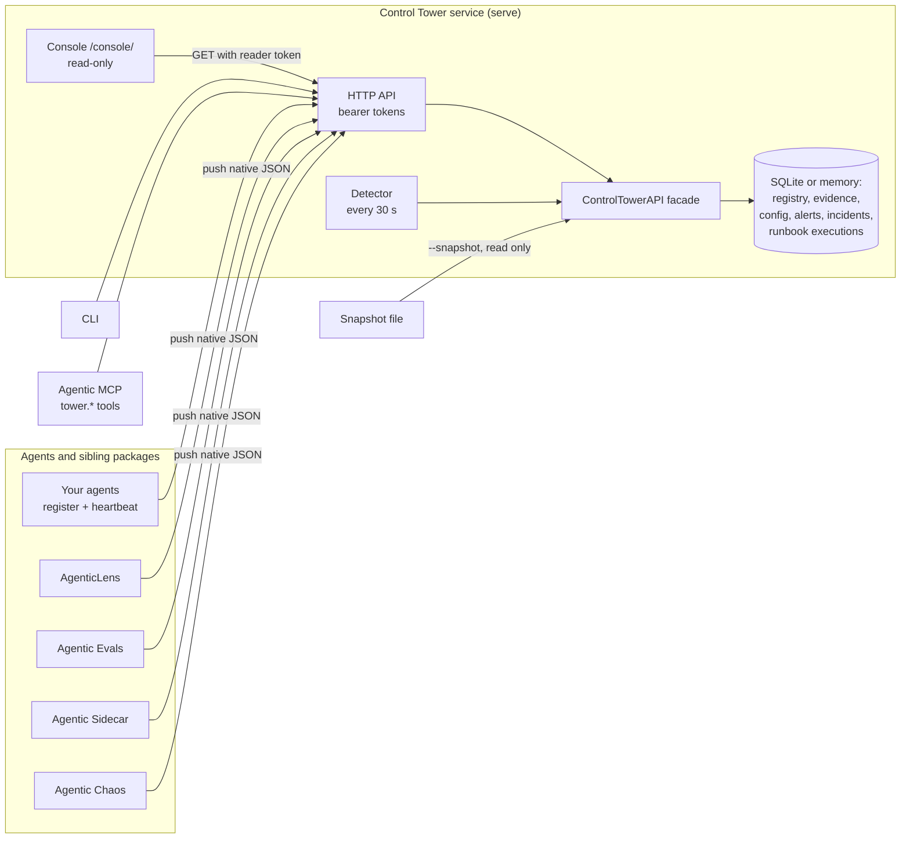

# Architecture

Control Tower is one Python package. A single `ControlTowerAPI` facade holds the
control model; the HTTP API, the CLI, offline snapshots and the console are all
thin surfaces over it, so they always agree.

- **Inventory first.** Agents register and report their own health; Tower
  aggregates, it does not probe.
- **Push, never pull.** Sibling results arrive as attributed native artifacts.
  Tower stores projections and never recomputes their verdicts.
- **Read-only surfaces, approved writes.** The console only reads. Configuration,
  bulk, recovery and runbook changes need a preview, a separate approval and an
  audit record.
- **Named actions, not commands.** Runbooks call host-installed connectors by
  action name with validated parameters; steps are claimed before dispatch and
  never replayed.

## Package layout

The package separates the following control-plane domains:

- `registry/` for agent registration and heartbeat state
- `discovery/` for capability and version discovery
- `api/` for a unified control-plane surface
- `config/` for centralized configuration contracts
- `cli/` for operator workflows
- `console/` for the packaged read-only AgenticOps Console
- `adapters/` for thin ecosystem integration boundaries
- `evidence/` for pushed evidence storage and freshness posture
- `incidents/` for incident investigation and approved recovery, `bulk/` for fleet operations, and `operations/` for live detection and alerts
- `runbooks/` for the versioned runbook catalog, connectors, staging fixture and approved bounded execution
- `status/` for fleet health and capability coverage rollups

See [README.md](https://github.com/DeepAgentLabs/agenticops-control-tower/blob/main/README.md) and [ROADMAP.md](roadmap.md) for the product
boundary and milestone order.

Deployment and operator setup: [hosting](hosting.md) and
[customer-managed authentication](authentication.md).

## v0.4 controlled configuration

See [configuration and approvals](configuration.md) for Tower ownership, action lifecycle, audit durability and API/CLI usage.
Runtime settings remain mirrored or unsupported without an adapter.
