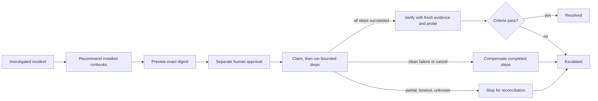

# Automated runbooks and recovery workflows (0.9.0)

Phase 9 turns the single approved staging action from 0.6.0 into reusable,
versioned runbooks. Tower owns the catalog, approvals, ordered execution,
cancellation, interruption handling and the incident timeline. Lens, Evals and
Chaos keep owning traces, scoring and fault injection; Tower only reads the
evidence they produce.



## Runbook definitions

A runbook is a host-installed `RunbookDefinition` identified by `runbook_id` and
a semantic `version`. Versions are immutable: installing the same version again
must match its digest, so an approval can never run a changed definition.

| Field | Meaning |
| --- | --- |
| `environments` | Deployment environments the runbook may target. |
| `prerequisites` | Any of `incident.open`, `incident.investigated`, `investigation.not_contradictory`, `connector.installed`. |
| `parameters` | Named string parameters, each with a regex `pattern` and optional `allowed` list. Preview must supply exactly these names. |
| `steps` | 1–10 ordered steps. Each names an `action`, a `timeout_seconds` (1–30), `max_attempts` (1–3) and an optional `rollback_action`. |
| `impact`, `rollback` | Operator-facing text retained in every preview. |
| `recovery` | Fixed criteria: connector probe, fresh successful Lens run, passing Evals gate, and a freshness window (default 300 s). |

The worst case, counting every attempt and every declared rollback, must fit in
120 seconds. Actions are identifiers such as `traffic.drain`, never commands,
URLs or credentials. Callers choose a catalog entry and parameter values; they
cannot supply steps.

Tower ships one definition, `staging.dependency_recovery` **1.0.0**:

| Step | Action | Attempts | Rollback |
| --- | --- | --- | --- |
| `drain` | `traffic.drain` | 1 | `traffic.resume` |
| `restore` | `dependency.restore` | 2 | none (restoring is not undone) |
| `resume` | `traffic.resume` | 2 | none |

Install your own versions with `RunbookCatalog([...])` or
`api.runbooks.catalog.install(definition)`.

## Connectors

A `RunbookConnector` is trusted host code installed per deployment with
`RunbookService(incidents, connectors={deployment_id: connector})` or
`api.runbooks.install(deployment_id, connector)`. It implements `supports`,
`run(idempotency_key, action, parameters)` and `probe`.

- Return `failed` only when the action made **no change**; Tower may retry it.
- Return `partial_failure` when state is unknown; Tower stops and never retries.
- Use the idempotency key durably. Tower passes `EXECUTION:STEP` for steps and
  `EXECUTION:STEP:rollback` for compensation; a repeated key after success must
  not repeat the side effect.

`StagingRunbookRuntime` is the supported deterministic fixture: a local SQLite
runtime that commits each change with its receipt. It is not a production
process manager. The default `serve` command installs no connector, so previews
fail honestly until a host installs one.

## Workflow

1. **Recommend.** `GET /incidents/{id}/runbooks` lists every installed version
   with `eligible`, the `unmet` prerequisites, its parameters, definition digest
   and validation status. The copilot can only choose from this list.
2. **Preview.** A writer posts `runbook_id`, `version`, `parameters` and optional
   `expires_in_seconds` (1–3600). Tower checks the environment, prerequisites and
   that the connector supports every step and rollback action with those
   parameters. The `preview_digest` binds the execution ID, incident, deployment,
   environment, definition digest, parameters and expiry. Previewing closes
   further investigation and the 0.6 single-action plan for that incident.
3. **Approve.** A separate approver posts the exact digest. The proposer cannot
   approve. Approvers can also revoke an unclaimed approval. A denied, revoked,
   cancelled or expired preview can be replaced by a new one; a dispatched one
   cannot.
4. **Execute.** A writer posts the digest. Tower re-checks the deployment's
   environment, the installed definition digest and connector support, consumes
   the approval and commits a `running` claim with an execution lease **before**
   any dispatch.
5. **Verify.** A writer posts `lens_evidence_id` and `evals_evidence_id` for the
   recovery run. Tower applies the same criteria as 0.6 recovery (see below) plus
   a bounded connector probe, then resolves or escalates the incident.

### Step outcomes

Each attempt is committed as `unknown` before the connector is called and is
bounded by the step timeout. Tower cannot kill a Python callback; a late call may
still finish, which is why timeouts are never retried.

| Connector result | Tower behavior | Runbook status |
| --- | --- | --- |
| `succeeded` | Next step | `awaiting_verification` after the last step |
| `failed` | Retry up to `max_attempts`; then compensate | `escalated` |
| `partial_failure`, timeout, exception or unsupported value | Stop. No retry, no compensation | `reconciliation_required` |
| Dispatch capacity full | Treated as `failed`; no call was made | as `failed` |

Compensation runs declared `rollback_action`s for succeeded steps in reverse
order. If any rollback is not clean, the runbook is `reconciliation_required`.
Steps after the stopping point are `skipped`. The incident is `escalated` in every
stopped case.

### Cancellation and interruption

`POST /runbook-executions/{id}/cancel` is available to writers and approvers.
Before execution it cancels without dispatch. During execution it stops before
the next step; the running step is not interrupted. Completed steps are then
compensated and the runbook ends `cancelled` with an escalated incident. A
cancellation that arrives after the last step has started has nothing left to
stop.

If the Tower process dies mid-run, the durable claim stays `running`. After the
lease (worst-case budget plus 30 seconds) a writer calls `reconcile`: claimed
steps keep `unknown`, others become `skipped`, the runbook becomes
`reconciliation_required` and nothing is replayed. Reconciling inside the lease
is rejected so a live execution is never declared lost.

### Recovery criteria

A runbook never resolves itself. Resolution requires all of:

- a successful connector probe within 5 seconds;
- an available native Lens run with `status=succeeded`, `task_success=true` and a
  run ID different from the detection run;
- a passing native Evals gate linked to that same run;
- both observed and ingested after execution started, no future timestamps, and
  observed within the runbook's freshness window;
- no failed Lens run for that run ID.

Unknown record IDs are rejected and leave the runbook awaiting verification.
Anything else that fails escalates.

## Chaos and Evals validation

`POST /runbooks/{runbook_id}/{version}/validations` records that a runbook version
was exercised under a controlled scenario. It takes `agent_id`,
`chaos_evidence_id` and `evals_evidence_id` for records already pushed to Tower.
It requires a completed native Chaos report and a passing Evals gate with the
same `run_id`, on a deployment in one of the runbook's environments.
Recommendations then report `validation: validated` with the validation IDs for
that definition digest and environment. Validation is evidence, not a gate: Tower
does not run Chaos experiments or compute Evals results.

## HTTP routes

All runbook routes need configured bearer credentials. Roles come from server
credentials, never request bodies. Errors in workflow order, role or scope return
409; unknown runbook versions return 404.

| Route | Role | Request |
| --- | --- | --- |
| `GET /runbooks` | reader | none |
| `GET /runbooks/{id}/{version}/validations` | reader | none |
| `POST /runbooks/{id}/{version}/validations` | writer | `agent_id`, `chaos_evidence_id`, `evals_evidence_id` |
| `GET /incidents/{id}/runbooks` | reader/writer/approver | none |
| `GET /incidents/{id}/runbook-executions` | reader/writer/approver | none |
| `POST /incidents/{id}/runbooks/preview` | writer | `runbook_id`, `version`, `parameters`, optional `expires_in_seconds` |
| `GET /runbook-executions/{id}` | reader/writer/approver | none |
| `POST /runbook-executions/{id}/approval` | separate approver | `preview_digest`, `approved` |
| `POST /runbook-executions/{id}/revoke` | approver | none |
| `POST /runbook-executions/{id}/execute` | writer | `preview_digest` |
| `POST /runbook-executions/{id}/cancel` | writer or approver | none |
| `POST /runbook-executions/{id}/verify` | writer | `lens_evidence_id`, `evals_evidence_id` |
| `POST /runbook-executions/{id}/reconcile` | writer | none; only after the lease |

Execution runs inside the request, bounded by the runbook's worst-case budget.
Incident views (`GET /incidents/{id}/view`) include a `runbooks` list, and every
runbook event is also an incident timeline event.

## CLI

```bash
agenticops-control-tower --token "$READER" runbooks catalog
agenticops-control-tower --token "$READER" runbooks recommend INCIDENT_ID
agenticops-control-tower --token "$WRITER" runbooks preview INCIDENT_ID preview.json
agenticops-control-tower --token "$APPROVER" runbooks approval EXECUTION_ID approval.json
agenticops-control-tower --token "$WRITER" runbooks execute EXECUTION_ID execute.json
agenticops-control-tower --token "$WRITER" runbooks verify EXECUTION_ID verify.json
```

Other commands: `history INCIDENT_ID`, `get`, `revoke`, `cancel` and `reconcile`
(each takes `EXECUTION_ID`), `validations RUNBOOK VERSION` and
`validate RUNBOOK VERSION FILE.json`. `execute` and `verify` exit 1 unless the
runbook is `awaiting_verification` or `resolved`. Snapshot mode rejects runbook
commands.

Example `preview.json`:

```json
{"runbook_id": "staging.dependency_recovery", "version": "1.0.0",
 "parameters": {"dependency": "search"}, "expires_in_seconds": 300}
```

## MCP

MCP 0.5.1 adds local `tower.runbooks`, `tower.runbook_recommendations`,
`tower.runbook_executions`, `tower.runbook_execution`, `tower.runbook_preview`,
`tower.runbook_execute`, `tower.runbook_cancel` and `tower.runbook_verify` tools.
They call these HTTP routes with the host's reader or writer credential, so the
same role, scope and approval checks apply. No MCP tool approves or revokes; a
human does that through HTTP or the CLI.

## Python

```python
from agenticops_control_tower.runbooks import RunbookService
from agenticops_control_tower.runbooks.models import RunbookPreviewRequest

runbooks = RunbookService(incidents, connectors={"staging": runtime})
execution = runbooks.preview(incident_id, RunbookPreviewRequest(
    runbook_id="staging.dependency_recovery", version="1.0.0",
    parameters={"dependency": "search"}), writer)
runbooks.decide(execution.execution_id, execution.preview_digest, True, approver)
runbooks.execute(execution.execution_id, execution.preview_digest, writer)
```

Pass the service as `ControlTowerAPI(..., runbook_service=runbooks)`; it must share
the API's incident service. Python callers are trusted hosts and must supply a
trusted `Operator`.

## Limits

- Steps are not atomic and there is no distributed exactly-once guarantee: Tower
  dispatches each step at most once per claim, and connectors own idempotency.
- Only `StagingRunbookRuntime` is supported. Production runtime connectors,
  multi-deployment runbooks and automatic approval are not provided.
- Timeouts bound how long Tower waits, not how long a connector runs.
- Recovery criteria are fixed in 0.9.0. Validation records are informational.
- Shared HTTP credentials are deployment-wide roles, not per-user identities.

See the [standalone example](https://github.com/DeepAgentLabs/agenticops-control-tower/blob/main/examples/runbook_recovery.py)
and [incident recovery](incident-recovery.md) for the 0.6 single-action flow,
which remains supported.
